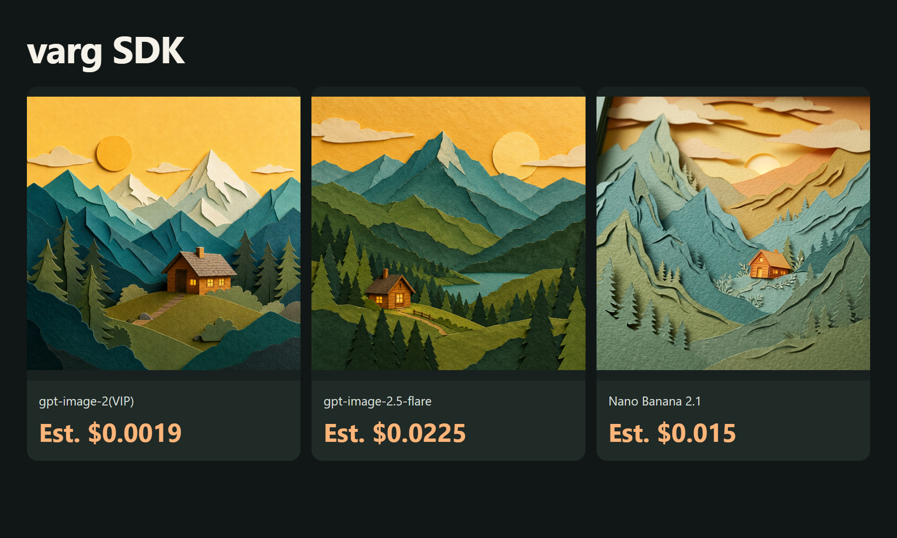
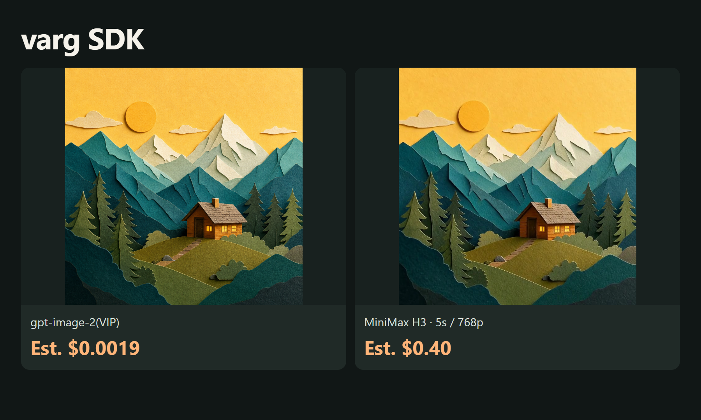

# Lower-cost varg SDK API asset examples

[English](README.md) · [中文](README_zh-CN.md)

Generate media and compose videos in code.

October 16, 2026: 3 real images and 1 real video. Catalog estimate for these completed assets: **$0.4394**; settled charges pending.

[ToAPIs · model pricing and setup](https://go2v.toapis.com/vg16ge)

## Examples



[](https://raw.githubusercontent.com/ToAPIs-2025/lower-cost-varg-sdk-toapis/main/demo/first-frame-motion.mp4)

[Play/download the real 5-second clip](https://raw.githubusercontent.com/ToAPIs-2025/lower-cost-varg-sdk-toapis/main/demo/first-frame-motion.mp4) · [MP4](demo/first-frame-motion.mp4)

## Models and costs in this run

| Model | Preset | Catalog estimate / output | Settled charge |
|---|---|---:|---|
| gpt-image-2(VIP) | low / 1K | $0.0019 | pending |
| gpt-image-2.5-flare | high / 1K | $0.0225 | pending |
| Nano Banana 2.1 | 1K | $0.015 | pending |
| MiniMax H3 | 5s / 768p / first-frame | $0.40 ($0.08/s) | pending |

These are catalog estimates for the specified presets, not confirmed settled charges. Different models/presets do not imply equal quality. See evidence and examples for task records and originals.

## Run it

```bash
python -m pip install -r requirements.txt
python run_case.py --job jobs/gpt-image-2-vip.json
# Set TOAPIS_API_KEY privately in your local environment first.
python run_case.py --job jobs/gpt-image-2-vip.json --live
python run_case.py --job jobs/video.json --live
```

Dry-run by default. --live explicitly enables paid calls. Stable run_id values preserve task receipts; uncertain submissions are not automatically retried. Never commit .env, keys or private task state.

## Integrating with the original project

[Project-specific integration notes](integration/README.md) · [API contract](integration/toapis-contract.json)

[varg SDK upstream](https://github.com/vargHQ/sdk) · SHA `c26974440bcdb37b42e13696cf58d3d17a636d6d`

These are original, independent ToAPIs asset/API examples, not an official upstream release or an accepted native provider. Full upstream UI, native registration and complete workflows still need maintainer acceptance. No upstream source is redistributed.
