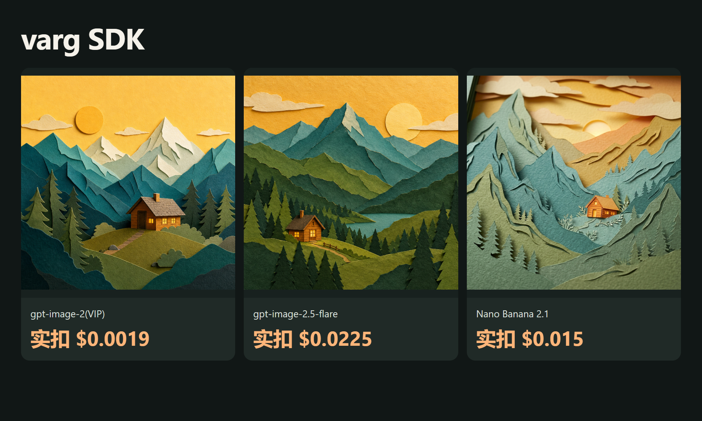
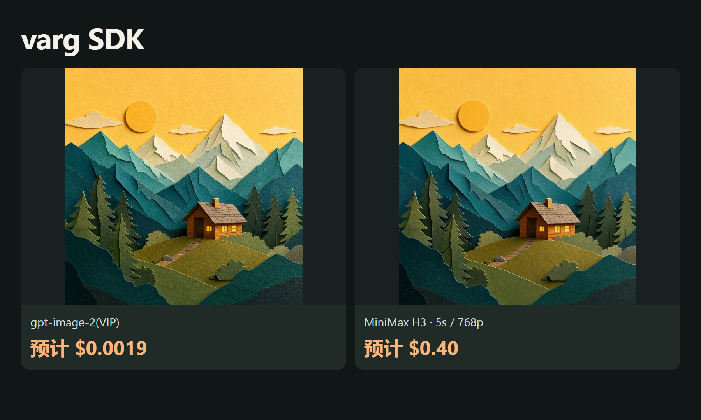

# 更低成本的 varg SDK API素材方案


<!-- TOAPIS-MODELS-20261020 -->
## 模型与价格更新 · 2026-10-20

新增可独立运行的31套图片请求模板、8套视频模板。当前26套图片与8套视频可匹配同Key精确价格；另5套图片缺价，默认阻止新付费调用。它们属于额外API脚本；项目原生Provider、UI、导入及完整出片的验收范围仍以下方原教程为准。

| 图片模型／实测档位 | 当前档位报价／张 | 历史案例金额／张 | 费用证据 |
|---|---:|---:|---|
| gpt-image-2(VIP)<br><sub>low</sub> | $0.0019/image | **$0.0019/image** | 计费日志，阶段未知 |
| gpt-image-2.5-flare-vip<br><sub>low</sub> | 当前Key暂未返回报价 | **$0.005272/image**<br><sub>Token计费；当前$/M未返回，本例金额不是固定单张价。</sub> | 任务回执已结算 |
| nano_banana<br><sub>1K</sub> | $0.012/image | **$0.012/image** | 计费日志，阶段未知 |
| gemini-nano-banana-2.1<br><sub>1K</sub> | $0.015/image | **$0.015/image** | 计费日志，阶段未知 |
| gpt-image-2<br><sub>1K</sub> | $0.015/image | **$0.015/image** | 计费日志，阶段未知 |
| gemini-nano-banana-2.1-vip<br><sub>1K</sub> | $0.02/image | **$0.02/image** | 计费日志，阶段未知 |
| qwen-image-3.0<br><sub>1K</sub> | 当前Key暂未返回报价 | **$0.021/image** | 计费日志，阶段未知 |
| gpt-image-2.5-flare<br><sub>high</sub> | $0.0225/image | **$0.0225/image** | 计费日志，阶段未知 |
| gpt-image-2.5-sunburst<br><sub>high</sub> | $0.0225/image | **$0.0225/image** | 计费日志，阶段未知 |
| flux-2-pro<br><sub>1K</sub> | $0.025/image | **$0.025/image** | 计费日志，阶段未知 |
| doubao-seedream-5-0-pro<br><sub>1K</sub> | $0.042857/image | **$0.042856/image** | 计费日志，阶段未知 |

| 视频模型 | 档位／输入 | 本例消费 | 文件时长 | 本例每秒金额（升序） |
|---|---|---:|---:|---|
| MiniMax-H3-Max-Turbo | 5s / 480P / 文生视频 | $0.125/clip | 5.18s | **$0.024131/s**<br><sub>pricing底层费率：$0.025/s</sub> |
| seedance-2-mini | 4s / 480p / 首帧 | $0.13338/clip | 4.04s | **$0.033015/s**<br><sub>pricing底层费率：$3.285714/M total tokens</sub> |
| seedance-2-fast | 4s / 480p / 文生视频 | $0.214568/clip | 4.04s | **$0.053111/s**<br><sub>pricing底层费率：$5.285714/M total tokens</sub> |
| kling-v3 | 5s / 720p / std / 文生视频 | $0.3/clip | 5.04s | **$0.059524/s**<br><sub>pricing底层费率：$0.06/s</sub> |
| MiniMax-H3 | 5s / 768p / 文生视频 | $0.32/clip | 5.17s | **$0.061896/s**<br><sub>pricing底层费率：$0.064/s</sub> |
| seedance-2 | 4s / 480p / 首帧 | $0.26676/clip | 4.04s | **$0.06603/s**<br><sub>pricing底层费率：$6.571429/M total tokens</sub> |
| kling-3.0-turbo | 4s / 720p / 文生视频 | $0.32/clip | 4.04s | **$0.079208/s**<br><sub>pricing底层费率：$0.08/s</sub> |
| seedance-2-5 | 4s / 480p / 文生视频 | $0.3883/clip | 4.04s | **$0.096114/s**<br><sub>pricing底层费率：$10/M total tokens</sub> |

报价核对：2026-10-20。图片案例日期2026-10-17；视频案例日期2026-10-20。表格按本例金额／秒金额排序，质量、分辨率和输入不同，不是同配置质量排名。图片日志的阶段未知，不能当作单任务最终净结算；当前报价与历史金额分别显示。视频金额均由billing=settled确认，$/s按实际文件时长折算，任务处理耗时不参与计算。Token模型不是固定每秒价，底层$/M只作小字补充。

gpt-image-2(VIP)通用价格为$0.0019/image起；本例low/1K为$0.0019/image。新脚本有31套历史成功图片请求模板、8套视频模板；当前26套图片与8套视频可匹配价格，另5套图片因当前Key缺价而默认阻止新付费调用。

[本仓库多模型脚本](toapis-models/README_zh-CN.md) · [完整价表](PRICING_zh-CN.md) · [原图／视频及费用证据](https://github.com/ToAPIs-2025/toapis-quickstart/tree/main/tutorials/model-support-2026-10-20)

下方保留原项目历史案例、消费及集成说明；历史金额不改成今天的新报价。

<!-- /TOAPIS-MODELS-20261020 -->

<!-- TOAPIS-MODEL-COST-UPDATE-20261016 -->
## 模型类型、测试档位与花费

更新：2026-10-16。下表为已验证案例的历史档位与价格；本段补充不改变下方原批次记录。

| 模型（API ID） | 类型 | 测试档位 | 单次报价 | 已确认单次消费 | 数量 |
|---|---|---|---:|---:|---:|
| gpt-image-2(VIP) (`gpt-image-2-vip`) | 图片 | low / 1K / n=1 | $0.0019/image | $0.0019 | 1 |
| gpt-image-2.5-flare | 图片 | high / 1K / n=1 | $0.0225/image | $0.0225 | 1 |
| Nano Banana 2.1 (`gemini-nano-banana-2.1`) | 图片 | 1K / n=1 | $0.015/image | $0.015 | 1 |
| MiniMax H3 (`MiniMax-H3`) | 视频 / 图生视频 | I2V / 5s / 768p / 1:1 | $0.4/clip | $0.4 | 1 |

原图片/视频案例已核对消费小计：**$0.4394**。

独立API素材已验证；上游原生注册、UI和完整工作流尚未验收。

gpt-image-2(VIP) **$0.0019/image 起**；本表 low/1K 实测档位为 **$0.0019/image**。不同模型、质量和分辨率不代表同质效果。

[视频补测、参数、费用与复用](video_extra/README_zh-CN.md)
<!-- /TOAPIS-MODEL-COST-UPDATE-20261016 -->


[English](README.md) · [中文](README_zh-CN.md)


用代码调用模型，再把素材编成视频。


2026-10-16：3张真实图片、1段真实视频；本批成功素材实扣 **$0.4394（87.88积分）**，已按后台导出逐任务核对。


[ToAPIs · 对应模型价格与接入](https://go2v.toapis.com/vg16gc)


## 案例





[](https://raw.githubusercontent.com/ToAPIs-2025/lower-cost-varg-sdk-toapis/main/demo/first-frame-motion.mp4)


[播放/下载本次5秒视频](https://raw.githubusercontent.com/ToAPIs-2025/lower-cost-varg-sdk-toapis/main/demo/first-frame-motion.mp4) · [MP4](demo/first-frame-motion.mp4)


## 本次模型与花费


| Model | Preset | Catalog estimate / output | Settled charge |

|---|---|---:|---|

| gpt-image-2(VIP) | low / 1K | $0.0019 | $0.0019 |

| gpt-image-2.5-flare | high / 1K | $0.0225 | $0.0225 |

| Nano Banana 2.1 | 1K | $0.015 | $0.015 |

| MiniMax H3 | 5s / 768p / first-frame | $0.40 ($0.08/s) | $0.4 |


对应配置的价表与本次实扣一致；实扣来自后台导出，1积分=$0.005。不同模型/画质不表示同等质量。逐任务记录和原始文件见evidence与examples。


## 怎么运行


```bash

python -m pip install -r requirements.txt

python run_case.py --job jobs/gpt-image-2-vip.json

# Set TOAPIS_API_KEY privately in your local environment first.

python run_case.py --job jobs/gpt-image-2-vip.json --live

python run_case.py --job jobs/video.json --live

```


默认只演练、不扣费。实际执行必须显式加--live；同一run_id保留任务记录，未知提交不自动重发。不要提交.env、Key或私有任务状态。


## 接入原项目


[项目对应接入说明](integration/README_zh-CN.md) · [API contract](integration/toapis-contract.json)


[varg SDK upstream](https://github.com/vargHQ/sdk) · SHA `c26974440bcdb37b42e13696cf58d3d17a636d6d`


这是ToAPIs原创、独立的素材/API示例，不是原项目官方版本或已验收原生Provider。完整上游UI、原生注册和全流程仍需维护者验收；公开包不包含上游源码。

